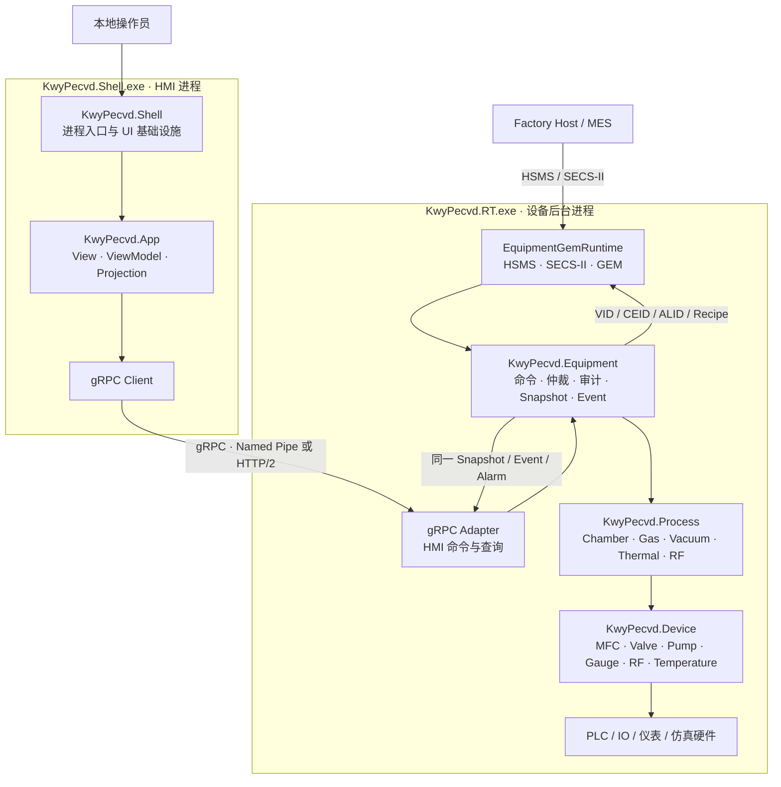
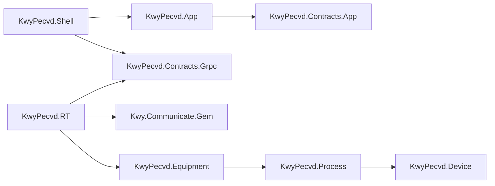

# KwyPecvd 双进程与 SECS/GEM 架构设计

## 1. 文档定位

本文档定义 `KwyTemplate.CS.slnx` 中 `KwyPecvd.*` 系列项目的长期架构方向，
重点说明：

- WPF HMI 与设备后台的双进程边界；
- gRPC 与 SECS/GEM 的位置；
- UI 命令与 Factory Host 命令如何进入同一设备业务入口；
- `Device → Process → Equipment` 的分层与事实所有权；
- `EquipmentGemRuntime` 的启停顺序与扩展边界；
- 当前代码与目标架构之间的迁移路径。

> 本文档同时描述“当前状态”和“目标结构”。未标记为已实现的能力，
> 不应被理解为已可用的生产功能。

## 2. 架构决策

### 2.1 保持两个进程

| 进程 | 项目 | 职责 |
|---|---|---|
| 设备后台 | `KwyPecvd.RT.exe` | 硬件生命周期、工艺状态机、设备命令、gRPC Server、SECS/GEM |
| 本地 HMI | `KwyPecvd.Shell.exe` | WPF、ViewModel、界面投影、gRPC Client |

SECS/GEM 优先作为 `KwyPecvd.RT` 内部模块，不增加第三个进程。
只有第三方 GEM SDK 稳定性、位数、独立升级或客户部署要求提供了明确理由时，
才考虑拆分 GEM 进程。

### 2.2 只有一套设备控制核心

```text
Local UI Command  ─┐
                   ├→ EquipmentCommandProcessor → Equipment State Machine → Process → Device
Factory Host RCMD ─┘
```

gRPC 和 GEM 都是外部适配入口，不得各自实现一套 Start、Stop、Recipe 或安全检查。

### 2.3 整机编排层命名为 KwyPecvd.Equipment

`KwyPecvd.App` 已表示 WPF UI 模块，为避免与 `Application` 混淆，
整机用例与命令编排层使用：

```text
KwyPecvd.Equipment
```

它代表 PECVD 整机，不代表通用 `Kwy.Device.*` 框架抽象。

## 3. 目标结构图



## 4. 项目职责与依赖

### 4.1 项目职责

| 项目 | 职责 | 不应包含 |
|---|---|---|
| `KwyPecvd.Shell` | WPF 进程入口、UI 基础设施、gRPC Client 生命周期 | 硬件实例、工艺状态机 |
| `KwyPecvd.App` | View、ViewModel、UI Projection | PLC、`ChamberController`、Secs4Net |
| `KwyPecvd.Contracts.App` | UI 内部抽象；后续可评估更名为 `KwyPecvd.App.Abstractions` | 跨进程业务实现 |
| `KwyPecvd.Contracts.Grpc` | `.proto`、生成的 Client/Server 合同 | Process/Device 实现 |
| `KwyPecvd.RT` | 后台进程、组合根、Hosted Service、gRPC/GEM Adapter | 第二套设备业务规则 |
| `KwyPecvd.Equipment` | 整机命令、权限、幂等、仲裁、审计、Recipe、Alarm、Snapshot/Event | WPF、gRPC、Secs4Net |
| `KwyPecvd.Process` | PECVD 工艺模块与状态机 | UI 与 Factory Host 协议对象 |
| `KwyPecvd.Device` | 硬件能力、驱动适配、硬件 Snapshot | 整机生产流程 |
| `KwyPecvd.Tests` | 状态机、命令、协议映射、崩溃与恢复验证 | 生产运行时依赖 |

`KwyPecvd.Process/Modules` 保存设备内部模块控制器的注册与周期调度抽象，包括 `IEquipmentModuleRegistry`、`IEquipmentModuleController` 和 `ICyclicEquipmentModuleController`。这里的 Equipment Module 指 Chamber、Load Lock、Transfer Module 等设备内部模块，不表示 `KwyPecvd.Equipment` 整机用例层，也不应移动到该项目中形成反向依赖。

### 4.2 允许的项目依赖



禁止反向依赖：

```text
Device   ✕→ Process / Equipment / RT / App
Process  ✕→ Equipment / RT / App / GEM
Equipment ✕→ gRPC / Secs4Net / WPF
App      ✕→ RT / Process / Device
```

## 5. KwyPecvd.Equipment 目标目录

```text
KwyPecvd.Equipment/
├─ Commands/
│  ├─ EquipmentCommandEnvelope.cs
│  ├─ EquipmentCommandSource.cs
│  ├─ EquipmentCommandResult.cs
│  ├─ IEquipmentCommandProcessor.cs
│  └─ EquipmentCommandProcessor.cs
├─ State/
│  ├─ EquipmentState.cs
│  ├─ EquipmentStateMachine.cs
│  └─ EquipmentSnapshot.cs
├─ Queries/
│  └─ IEquipmentSnapshotProvider.cs
├─ Events/
│  ├─ EquipmentEvent.cs
│  └─ IEquipmentEventPublisher.cs
├─ Alarms/
│  └─ IEquipmentAlarmService.cs
└─ Recipes/
   └─ IEquipmentRecipeService.cs
```

该层对外提供的核心是用例，而不是硬件原语：

```text
InitializeEquipment
StartProcess
StopProcess
PauseProcess
ResumeProcess
AbortProcess
SelectRecipe
ResetFault
```

直接开阀、设置 RF、修改温控目标等原语属于受控维护能力，
不应成为 HMI 或 Factory Host 的普通生产接口。

## 6. 统一命令链路

### 6.1 本地 HMI

```text
WPF ViewModel
→ gRPC Client
→ EquipmentGrpcService
→ EquipmentCommandEnvelope(Source = LocalUi)
→ IEquipmentCommandProcessor
→ EquipmentStateMachine
→ IChamberController
```

### 6.2 Factory Host

```text
S2F41
→ S2F41Handler
→ GemRemoteCommandRequest
→ PecvdGemCommandBindings
→ EquipmentCommandEnvelope(Source = FactoryHost)
→ IEquipmentCommandProcessor
→ EquipmentStateMachine
→ IChamberController
→ GemRemoteCommandResult
→ S2F42
```

`S2F42 Accepted` 只表示命令已经通过必要检查并被可靠接收，
不表示物理动作已完成。耗时动作的最终结果通过统一 Equipment Event 产生，
并按客户合同映射为 S6F11 Collection Event。

## 7. EquipmentGemRuntime

### 7.1 放置位置

```text
KwyPecvd.RT/
└─ Gem/
   ├─ EquipmentGemRuntime.cs
   ├─ PecvdGemCommandBindings.cs
   ├─ PecvdGemDataProjection.cs
   ├─ PecvdGemDiagnostics.cs
   ├─ PecvdProcessProgramRepository.cs
   ├─ PecvdGemHandlerPolicies.cs
   └─ Profiles/
      └─ pecvd-default.json
```

### 7.2 职责

`EquipmentGemRuntime` 负责：

- 加载并校验 GEM Profile；
- 创建 `GemRegistry`；
- 绑定 Remote Command 与 `IEquipmentCommandProcessor`；
- 调用 `SealConfiguration()` 封闭启动配置；
- 创建 `ISecsGemClient` 与 `IGemEquipmentSession`；
- 注册标准 SxFy Handler；
- 启动 HSMS 并运行 `GemPrimaryMessageRouter`；
- 在进程停止时按逆序断开并释放资源。

`EquipmentGemRuntime` 不负责：

- 直接读写 PLC；
- 直接查找并操作阀、泵、MFC、RF 或温控器；
- 实现第二套 Recipe、Alarm、Equipment State 或安全规则；
- 把 `GemRegistry.Data` 当作 PECVD 的权威状态源。

### 7.3 启动顺序

```text
1. 加载进程配置与诊断
2. 创建并注册硬件组件
3. 创建 Process Module 与状态机
4. 创建 KwyPecvd.Equipment 服务
5. 初始化硬件并建立 Equipment Readiness
6. 启动 gRPC Server
7. 加载 GEM Profile、注册 Handler 并 Seal
8. 启动 HSMS/GEM
9. 运行 Router、Snapshot 投影、Event/Alarm 上报
```

HSMS 可以建立连接，但在设备未 Ready 前不得允许进入可接受远程生产命令的状态。

## 8. 状态与事实所有权

### 8.1 三套状态分开

| 状态 | 权威模块 | 含义 |
|---|---|---|
| `GemCommunicationState` | `Kwy.Communicate.Gem` | Factory Host 是否已建立 GEM 通信 |
| `GemControlState` | `Kwy.Communicate.Gem` + Equipment 授权策略 | Offline / OnlineLocal / OnlineRemote |
| `EquipmentState` / `ChamberState` | `KwyPecvd.Equipment` / `KwyPecvd.Process` | 设备和工艺的实际运行状态 |

不得合并成 `OnlineRemoteProcessing` 类似的组合枚举。

### 8.2 统一数据源

```text
Equipment / Process Snapshot
├─ gRPC Projection → HMI
└─ GEM Projection
   ├─ VID
   ├─ CEID / RPTID
   └─ ALID
```

- GEM VID 来自同一 Equipment Snapshot；
- GEM Alarm 映射同一 Alarm Service；
- GEM Collection Event 映射同一 Equipment Event；
- S7 Process Program 进入同一 Recipe 校验、版本、发布与审计流程；
- HMI 与 Factory Host 不得拥有各自的设备状态副本。

## 9. gRPC 合同

`KwyPecvd.Contracts.Grpc/Protos/v1` 建议从以下合同起步：

```text
bootstrap.proto
equipment_command.proto
equipment_snapshot.proto
equipment_event.proto
alarm.proto
recipe.proto
```

初期可保持一个聚合服务：

```text
GetCompatibility
GetSnapshot
SubmitCommand
SubscribeEvents
```

HMI 启动链路：

```text
连接 RT
→ GetCompatibility
→ GetSnapshot
→ SubscribeEvents
→ 根据权限、状态和 Capability 开放 UI 操作
```

RT 不可达或合同不兼容时，HMI 应显示不可用/未知，不得默认设备为 `Idle`。

## 10. 生产命令与维护命令

### 10.1 生产命令

```text
InitializeEquipment
SelectRecipe
StartProcess
StopProcess
PauseProcess
ResumeProcess
AbortProcess
ResetFault
```

必须通过 `IEquipmentCommandProcessor`，并统一执行：

- 命令来源与请求者识别；
- 控制权与权限验证；
- 幂等性检查；
- 状态与安全联锁检查；
- 命令仲裁；
- 审计与最终结果记录。

### 10.2 维护命令

以下能力应放入受控 Maintenance Service：

```text
单独开关阀
直接修改 MFC 目标
直接设置温控器
直接操作 RF 电源或 Matcher
```

必须受 Maintenance Mode、本地授权、安全状态和审计约束，
不应直接暴露为 Factory Host 普通 RCMD。

## 11. GEM300 的位置

`Kwy.Communicate.Gem300` 当前为 alpha，定位于 E40/E87/E90/E94 等对象模型与适配。
当前 PECVD 主要具备 PM Chamber、Gas、Vacuum、Thermal 和 RF 能力，
尚未建立完整的 Load Port、Carrier、Slot Map、Substrate Tracking、Process Job 和 Control Job 权威模型。

因此当前阶段：

1. 先完成统一 Equipment 命令、Snapshot 和 Event；
2. 再建立 Recipe、Lot、Carrier、Wafer/Substrate 权威模型；
3. 只在设备范围和客户规范确实要求时接入 GEM300；
4. GEM300 始终是 Factory Host 适配层，不得取代 PECVD 内部业务事实源。

## 12. 当前实现状态

### 12.1 已有基础

- `KwyPecvd.Shell` 和 `KwyPecvd.RT` 已分为两个可执行进程；
- `KwyPecvd.Device` 已建立硬件接口、基类、仿真实现与 Snapshot；
- `KwyPecvd.Process` 已建立 Chamber 与 Gas/Vacuum/Thermal/RF 状态控制；
- `EquipmentRuntimeService` 已统一调度硬件周期与模块周期；
- `KwyPecvd.RT` 已提供 HTTP 诊断与试验性命令入口。

### 12.2 尚未完成

- `KwyPecvd.Contracts.Grpc` 尚未包含正式 `.proto`；
- HMI 尚未通过 gRPC 与 RT 建立完整链路；
- `KwyPecvd.Equipment` 尚未创建；
- 统一命令处理、幂等、仲裁、审计与设备级 Snapshot/Event 尚未完成；
- `KwyPecvd.RT` 尚未引用 `Kwy.Communicate.Gem`；
- `EquipmentGemRuntime` 与 PECVD GEM Profile 尚未实现；
- GEM300 不在当前实施范围内。

## 13. 迁移计划

### 阶段 1：整理 RT 组合根

- 将硬件和 Chamber 创建从 `Program.cs` 拆入 `PecvdEquipmentComposition`；
- 将诊断查询拆入 `PecvdDiagnosticEndpoints`；
- 将底层手动操作拆入受控 `PecvdMaintenanceEndpoints`；
- 保持现有硬件与模块周期行为不变。

### 阶段 2：建立 KwyPecvd.Equipment

- 增加整机命令、命令来源与处理结果；
- 实现 `IEquipmentCommandProcessor`；
- 建立 Equipment State/Snapshot/Event/Alarm；
- 将正式生产命令从 HTTP Endpoint 收口到 Command Processor。

### 阶段 3：完成 gRPC 双进程链路

- 定义 v1 Protobuf 合同；
- RT 实现 gRPC Server；
- Shell/App 实现 gRPC Client；
- 实现兼容性握手、Snapshot 获取与 Event 订阅；
- 验证 HMI 断线、RT 重启、版本不兼容和事件缺口。

### 阶段 4：接入 SECS/GEM

- RT 引用 `Kwy.Communicate.Gem`；
- 实现 `EquipmentGemRuntime`、Profile 与 Diagnostics 适配；
- 将 S2F41 RCMD 映射到统一 Command Processor；
- 将 Equipment Snapshot/Event/Alarm/Recipe 映射到 VID/CEID/ALID/S7；
- 使用 Host Simulator 和 `Kwy.Communicate.Gem.Testing` 执行验收。

### 阶段 5：按客户范围接入 GEM300

- 先完成 Carrier/Substrate/Job 内部权威模型；
- 再使用 `Kwy.Communicate.Gem300` 适配 E40/E87/E90/E94；
- 严格依据正式 SEMI 标准与客户 Interface Specification 验证。

## 14. 架构验收不变量

- HMI 与 Factory Host 使用同一设备命令处理器；
- GEM Adapter 不直接操作 PLC 或硬件 Registry；
- gRPC Adapter 不直接实现设备业务规则；
- 未知或不兼容状态禁止生产控制；
- 非幂等命令不会因超时、重试或重连重复执行；
- Recipe 未发布、校验失败或 Hash 不匹配时不得生产；
- HMI 与 GEM 的状态、Alarm 和 Event 来自同一事实源；
- `S2F42 Accepted` 不被误解为物理动作已完成；
- HMI 崩溃不影响 RT 设备控制；
- RT 重启后通过 Checkpoint/Reconcile 恢复，不伪造 `Idle`；
- 安全相关未知状态一律进入受控状态并要求人工干预。

