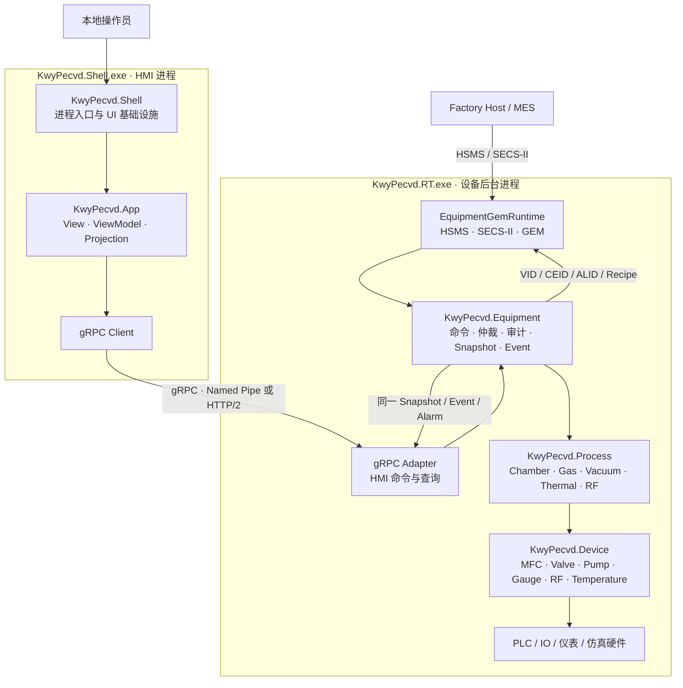
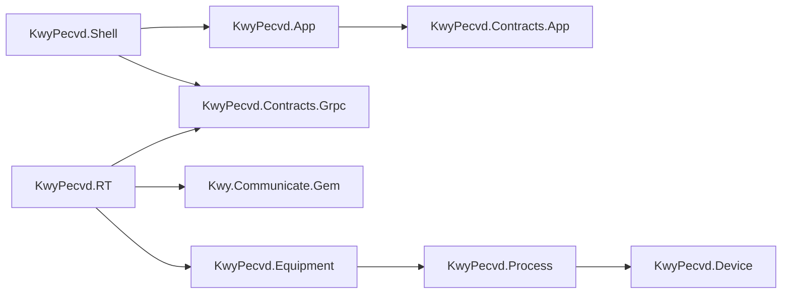

# KwyPecvd 双进程与 SECS/GEM 架构设计

## 1. 文档定位

本文档定义 `KwyTemplate.CS.slnx` 中 `KwyPecvd.*` 系列项目的长期架构方向，
重点说明：

- WPF HMI 与设备后台的双进程边界；
- gRPC 与 SECS/GEM 的位置；
- UI 命令与 Factory Host 命令如何进入同一设备业务入口；
- `Device → Process → Equipment` 的分层与事实所有权；
- `EquipmentGemRuntime` 的启停顺序与扩展边界；
- 当前代码与目标架构之间的迁移路径。

> 本文档同时描述“当前状态”和“目标结构”。未标记为已实现的能力，
> 不应被理解为已可用的生产功能。

## 2. 架构决策

### 2.1 保持两个进程

| 进程 | 项目 | 职责 |
|---|---|---|
| 设备后台 | `KwyPecvd.RT.exe` | 硬件生命周期、工艺状态机、设备命令、gRPC Server、SECS/GEM |
| 本地 HMI | `KwyPecvd.Shell.exe` | WPF、ViewModel、界面投影、gRPC Client |

SECS/GEM 优先作为 `KwyPecvd.RT` 内部模块，不增加第三个进程。
只有第三方 GEM SDK 稳定性、位数、独立升级或客户部署要求提供了明确理由时，
才考虑拆分 GEM 进程。

### 2.2 只有一套设备控制核心

```text
Local UI Command  ─┐
                   ├→ EquipmentCommandProcessor → Process → Device
Factory Host RCMD ─┘                         ↑
                   EquipmentCommandCompletionObserver ┘
```

gRPC 和 GEM 都是外部适配入口，不得各自实现一套 Start、Stop、Recipe 或安全检查。

### 2.3 整机编排层命名为 KwyPecvd.Equipment

`KwyPecvd.App` 已表示 WPF UI 模块，为避免与 `Application` 混淆，
整机用例与命令编排层使用：

```text
KwyPecvd.Equipment
```

它代表 PECVD 整机，不代表通用 `Kwy.Device.*` 框架抽象。

## 3. 目标结构图



## 4. 项目职责与依赖

### 4.1 项目职责

| 项目 | 职责 | 不应包含 |
|---|---|---|
| `KwyPecvd.Shell` | WPF 进程入口、UI 基础设施、gRPC Client 生命周期 | 硬件实例、工艺状态机 |
| `KwyPecvd.App` | View、ViewModel、UI Projection | PLC、`ChamberController`、Secs4Net |
| `KwyPecvd.Contracts.App` | UI 内部抽象；后续可评估更名为 `KwyPecvd.App.Abstractions` | 跨进程业务实现 |
| `KwyPecvd.Contracts.Grpc` | `.proto`、生成的 Client/Server 合同 | Process/Device 实现 |
| `KwyPecvd.RT` | 后台进程、组合根、Hosted Service、gRPC/GEM Adapter | 第二套设备业务规则 |
| `KwyPecvd.Equipment` | 整机命令、权限、幂等、仲裁、审计、Recipe、Alarm、Snapshot/Event | WPF、gRPC、Secs4Net |
| `KwyPecvd.Process` | PECVD 工艺模块与状态机 | UI 与 Factory Host 协议对象 |
| `KwyPecvd.Device` | 硬件能力、驱动适配、硬件 Snapshot | 整机生产流程 |
| `KwyPecvd.Tests` | 状态机、命令、协议映射、崩溃与恢复验证 | 生产运行时依赖 |

`KwyPecvd.Process/Modules` 保存设备内部模块控制器的注册与周期调度抽象，包括 `IEquipmentModuleRegistry`、`IEquipmentModuleController` 和 `ICyclicEquipmentModuleController`。这里的 Equipment Module 指 Chamber、Load Lock、Transfer Module 等设备内部模块，不表示 `KwyPecvd.Equipment` 整机用例层，也不应移动到该项目中形成反向依赖。

### 4.2 允许的项目依赖



禁止反向依赖：

```text
Device   ✕→ Process / Equipment / RT / App
Process  ✕→ Equipment / RT / App / GEM
Equipment ✕→ gRPC / Secs4Net / WPF
App      ✕→ RT / Process / Device
```

## 5. KwyPecvd.Equipment 整体设计

### 5.1 它在分层中的位置

`KwyPecvd.Equipment` 是 PECVD 整机的应用用例与协调层。它不直接控制硬件，
也不实现 Chamber 内部的气体、真空、温控或 RF 状态机。它回答的是：

> 某个来源的调用者，在当前整机语义下，能否对某个设备模块提交某条业务命令；
> 命令是否被受理；耗时的物理动作最终是完成还是失败；结果如何被查询和发布。

当前依赖方向为：

```text
KwyPecvd.RT
    ↓ 组合、调度、HTTP/gRPC/GEM 适配
KwyPecvd.Equipment
    ↓ 调用工艺模块的业务能力
KwyPecvd.Process
    ↓ 调用硬件能力
KwyPecvd.Device
```

这个方向保证 `Equipment` 不知道 HTTP、gRPC、SECS-II、Secs4Net 或 WPF，
因此本地 HMI、Factory Host 和诊断入口可以共用同一套命令规则。

### 5.2 为什么不把这些逻辑放进 Process

`KwyPecvd.Process` 拥有“Chamber 如何运行”的事实，例如：

- `Processing → Stopping → Idle/Faulted` 状态迁移；
- MFC 流量、阀门位置、真空度和稳定时间是否达标；
- 停止超时或硬件故障如何进入 `Faulted`。

`KwyPecvd.Equipment` 拥有“谁在执行哪条整机命令”的事实，例如：

- 命令来自 Local UI、Factory Host、Diagnostic 还是 System；
- `RequestId` 是什么，谁是 `Requester`；
- 同一模块是否已有一条待完成的 Stop；
- 给外部返回 `Accepted`、`Rejected`、`Completed` 还是 `Failed`；
- 最终结果应该如何查询、审计和发布。

因此，Process 状态不能替代 Command 状态：

```text
Process State: Processing → Stopping → Idle/Faulted
Command State: Accepted  → Completed/Failed
```

`PendingEquipmentCommand` 和 `EquipmentCommandCompletionObserver` 是连接这两条生命周期的桥梁。

### 5.3 当前已实现的目录

```text
KwyPecvd.Equipment/
├─ Commands/
│  ├─ EquipmentCommandModels.cs
│  │  ├─ IEquipmentCommand
│  │  ├─ EquipmentCommandSource
│  │  ├─ EquipmentCommandContext
│  │  ├─ EquipmentCommandEnvelope
│  │  ├─ EquipmentCommandStatus
│  │  └─ EquipmentCommandResult
│  ├─ EquipmentCommands.cs
│  │  ├─ InitializeEquipmentCommand
│  │  ├─ ResetEquipmentFaultCommand
│  │  └─ StopProcessCommand
│  ├─ EquipmentCommandCodes.cs
│  ├─ IEquipmentCommandProcessor.cs
│  ├─ EquipmentCommandProcessor.cs
│  ├─ EquipmentCommandResultSnapshot.cs
│  ├─ IEquipmentCommandResultStore.cs
│  ├─ InMemoryEquipmentCommandResultStore.cs
│  ├─ Pending/
│  │  ├─ PendingEquipmentCommand.cs
│  │  ├─ IPendingEquipmentCommandStore.cs
│  │  └─ InMemoryPendingEquipmentCommandStore.cs
│  └─ Completion/
│     ├─ IEquipmentCommandCompletionObserver.cs
│     └─ EquipmentCommandCompletionObserver.cs
└─ Events/
   ├─ EquipmentEvent.cs
   ├─ EquipmentEventCodes.cs
   └─ IEquipmentEventPublisher.cs
```

`Class1.cs` 是项目创建时的默认占位文件，不承载业务职责，可删除。

### 5.4 命令模型

`IEquipmentCommand` 只表示业务意图，不携带 HTTP、gRPC 或 GEM 协议对象。

```text
EquipmentCommandEnvelope
├─ Context
│  ├─ RequestId
│  ├─ Source
│  ├─ Requester
│  └─ RequestedAt
└─ Command
   └─ StopProcessCommand(EquipmentModuleId = "PM1")
```

- `Context` 说明这次调用的身份、来源和跟踪信息；
- `Command` 说明要执行的业务意图；
- `Envelope` 将两者组合，使 Processor 不依赖具体通信协议。

`EquipmentCommandSource` 当前包含：

| 值 | 含义 |
|---|---|
| `LocalUi` | 本地 HMI 操作员 |
| `FactoryHost` | Factory Host 通过 SECS/GEM 提交 |
| `Diagnostic` | HTTP 诊断或联调入口 |
| `System` | RT 内部策略或后台任务 |

### 5.5 Processor 的职责

`EquipmentCommandProcessor` 是所有正式整机命令的统一入口。当前它负责：

1. 根据具体 Command 类型分派用例；
2. 校验 `EquipmentModuleId` 并通过 `IEquipmentModuleRegistry` 解析 Process Module；
3. 将 `Initialize` 和 `ResetFault` 这类当场完成的命令直接转换为 `Completed/Rejected`；
4. 为 `StopProcess` 这类跨多个 RT 周期的命令建立 Pending；
5. 防止同一模块同时存在两条待完成的 Stop；
6. 记录可以按 `RequestId` 查询的命令结果。

当前命令的处理语义：

| 命令 | Process 调用返回时的语义 | 是否需要 Pending |
|---|---|---:|
| `InitializeEquipmentCommand` | 初始化已完成或已拒绝 | 否 |
| `ResetEquipmentFaultCommand` | 故障复位已完成或已拒绝 | 否 |
| `StopProcessCommand` | 已接受安全停止请求，物理动作未完成 | 是 |

### 5.6 Command Status 的精确含义

| 状态 | 含义 |
|---|---|
| `Accepted` | Equipment 已可靠登记命令，但耗时动作尚未完成 |
| `Completed` | 已从 Process 的最终真实状态确认命令成功完成 |
| `Rejected` | 命令没有进入异步执行，例如参数错误、模块不存在或 Process 当场拒绝 |
| `Failed` | 命令进入受理/执行后出现异常，或后续 Process 进入 `Faulted` |

允许的主要转换是：

```text
Accepted ──→ Completed
    │
    ├──────→ Rejected
    │
    └──────→ Failed
```

`InMemoryEquipmentCommandResultStore` 对终态进行保护：一旦是 `Completed`、`Rejected`
或 `Failed`，晚到的 `Accepted` 不得将其覆盖。这用于防止 HTTP 命令线程和
RT 周期线程并发更新时出现结果倒退。

### 5.7 Pending Store 和 Result Store 不是同一个概念

| Store | 回答的问题 | 何时删除/更新 |
|---|---|---|
| `IPendingEquipmentCommandStore` | 某模块的某种异步命令是否尚未完成 | 最终完成/失败时 `TryTake`，Process 当场拒绝时 `TryRemove` |
| `IEquipmentCommandResultStore` | 按 `RequestId` 查询命令当前或最终结果 | `Accepted` 后更新为 `Completed/Rejected/Failed` |

Pending 不是命令历史。它的组合键是：

```text
EquipmentModuleId + CommandTypeCode
```

因此 `PM1 + StopProcess` 已存在时，第二条 PM1 Stop 会被拒绝；PM2 的 Stop
或 PM1 的其他命令不一定被阻止。

Result Store 按 `RequestId` 寻址，为 HTTP/gRPC 的 Pull 查询提供数据。

### 5.8 StopProcess 异步闭环

```text
HTTP / gRPC / GEM
    ↓ EquipmentCommandEnvelope
EquipmentCommandProcessor
    ├─ TryAdd Pending
    ├─ Result Store = Accepted
    └─ IChamberController.StopProcessAsync()
            ↓
        Chamber: Processing → Stopping
            ↓ 多个 100ms RT 周期
        硬件 Snapshot 更新
            ↓
        Chamber.ExecuteCycleAsync()
            ├─ 未停稳：保持 Stopping
            ├─ 停稳：Idle
            └─ 超时/故障：Faulted
            ↓
EquipmentCommandCompletionObserver
    ├─ Stopping：不处理，Pending 继续保留
    ├─ Idle：TryTake Pending → Completed
    └─ Faulted：TryTake Pending → Failed
            ↓
IEquipmentEventPublisher.PublishAsync()
            ↓
Result Store = Completed / Failed
```

Observer 没有自己的定时器。`KwyPecvd.RT/EquipmentRuntimeService` 是唯一的周期调度者：

```text
每个周期：
1. Hardware Component 周期：写目标、读反馈、更新硬件 Snapshot
2. Process Module 周期：读取硬件 Snapshot 并推进状态机
3. Completion Observer：读取推进后的最新状态，完成异步命令
```

如果 Process Module 周期失败，当前周期不得继续调用 Observer，避免使用旧 Snapshot
误判命令完成。

### 5.9 Event Publisher 的边界

`IEquipmentEventPublisher` 是 Equipment 层定义的输出端口：

```text
KwyPecvd.Equipment                 KwyPecvd.RT / Adapter
EquipmentCommandCompletionObserver → IEquipmentEventPublisher
                                      ├─ LoggingEquipmentEventPublisher（当前）
                                      ├─ gRPC Event Stream（目标）
                                      └─ GEM S6F11 Publisher（目标）
```

Equipment 只发布协议无关的 `EquipmentEvent`。GEM Adapter 负责将它映射为 CEID/RPTID，
gRPC Adapter 负责将它映射为订阅流。Observer 不得直接引用 GEM 或 gRPC 类型。

HTTP 查询和 Event Publisher 不互相替代：

```text
IEquipmentCommandResultStore → Pull：调用者按 RequestId 查询
IEquipmentEventPublisher     → Push：设备主动通知 HMI/Host
```

### 5.10 该层不应包含什么

- 不应包含 ASP.NET Endpoint、gRPC Service、Secs4Net Handler 或 WPF ViewModel；
- 不应直接查找 PLC、MFC、Valve、Pump、RF 或 Temperature Controller；
- 不应再实现一套 Chamber 气体/真空状态机；
- 不应把 GEM Registry 或 HTTP JSON 当成设备业务事实；
- 不应将直接开阀、修改 MFC/RF/温控目标暴露为普通生产命令。

这些底层原语应位于受 Maintenance Mode、本地授权、互锁和审计保护的维护入口。

### 5.11 当前限制与后续演进

当前已经跑通命令异步闭环，但仍有以下生产化工作：

1. `Pending` 和 `Result` 都是内存 Store，RT 重启后不保留；
2. Result Store 尚未实现保留期限和低频清理；
3. Event 发布尚无持久化 Outbox，“业务已完成”与“通知已送达”尚未完全分离；
4. Completion Observer 当前只支持 `StopProcessCommand`，第二个真实异步命令出现时再提取 Completion Rule；
5. 权限、Control State、幂等、审计、Recipe、Alarm 和整机 Snapshot 仍属于后续目标；
6. 当前权威运行状态主要是 Process 层的 `ChamberState`，尚未实现独立的 `EquipmentStateMachine`。

未来增加的整机用例应保持业务粒度：

```text
InitializeEquipment
StartProcess
StopProcess
PauseProcess
ResumeProcess
AbortProcess
SelectRecipe
ResetFault
```

直接开阀、设置 RF、修改温控目标等原语不应成为 HMI 或 Factory Host
的普通生产接口。

## 6. 统一命令链路

### 6.1 本地 HMI

```text
WPF ViewModel
→ gRPC Client
→ EquipmentGrpcService
→ EquipmentCommandEnvelope(Source = LocalUi)
→ IEquipmentCommandProcessor
→ IChamberController
```

### 6.2 Factory Host

```text
S2F41
→ S2F41Handler
→ GemRemoteCommandRequest
→ PecvdGemCommandBindings
→ EquipmentCommandEnvelope(Source = FactoryHost)
→ IEquipmentCommandProcessor
→ IChamberController
→ GemRemoteCommandResult
→ S2F42
```

上述是当前命令执行链的目标适配方式；当前 Processor 内部直接调用
`IChamberController`。未来的 Control State、权限、互锁和整机状态策略应作为
Processor 前后的可组合策略/状态层加入，不应让 gRPC 或 GEM Adapter 自己实现。

`S2F42 Accepted` 只表示命令已经通过必要检查并被可靠接收，
不表示物理动作已完成。耗时动作的最终结果通过统一 Equipment Event 产生，
并按客户合同映射为 S6F11 Collection Event。

## 7. EquipmentGemRuntime

### 7.1 放置位置

```text
KwyPecvd.RT/
└─ Gem/
   ├─ EquipmentGemRuntime.cs
   ├─ PecvdGemCommandBindings.cs
   ├─ PecvdGemDataProjection.cs
   ├─ PecvdGemDiagnostics.cs
   ├─ PecvdProcessProgramRepository.cs
   ├─ PecvdGemHandlerPolicies.cs
   └─ Profiles/
      └─ pecvd-default.json
```

### 7.2 职责

`EquipmentGemRuntime` 负责：

- 加载并校验 GEM Profile；
- 创建 `GemRegistry`；
- 绑定 Remote Command 与 `IEquipmentCommandProcessor`；
- 调用 `SealConfiguration()` 封闭启动配置；
- 创建 `ISecsGemClient` 与 `IGemEquipmentSession`；
- 注册标准 SxFy Handler；
- 启动 HSMS 并运行 `GemPrimaryMessageRouter`；
- 在进程停止时按逆序断开并释放资源。

`EquipmentGemRuntime` 不负责：

- 直接读写 PLC；
- 直接查找并操作阀、泵、MFC、RF 或温控器；
- 实现第二套 Recipe、Alarm、Equipment State 或安全规则；
- 把 `GemRegistry.Data` 当作 PECVD 的权威状态源。

### 7.3 启动顺序

```text
1. 加载进程配置与诊断
2. 创建并注册硬件组件
3. 创建 Process Module 与状态机
4. 创建 KwyPecvd.Equipment 服务
5. 初始化硬件并建立 Equipment Readiness
6. 启动 gRPC Server
7. 加载 GEM Profile、注册 Handler 并 Seal
8. 启动 HSMS/GEM
9. 运行 Router、Snapshot 投影、Event/Alarm 上报
```

HSMS 可以建立连接，但在设备未 Ready 前不得允许进入可接受远程生产命令的状态。

## 8. 状态与事实所有权

### 8.1 三套状态分开

| 状态 | 权威模块 | 含义 |
|---|---|---|
| `GemCommunicationState` | `Kwy.Communicate.Gem` | Factory Host 是否已建立 GEM 通信 |
| `GemControlState` | `Kwy.Communicate.Gem` + Equipment 授权策略 | Offline / OnlineLocal / OnlineRemote |
| `ChamberState`（当前） | `KwyPecvd.Process` | Chamber 工艺的实际运行状态 |
| `EquipmentState`（目标） | `KwyPecvd.Equipment` | 整机级聚合状态，尚未实现 |

不得合并成 `OnlineRemoteProcessing` 类似的组合枚举。

### 8.2 统一数据源

```text
Equipment / Process Snapshot
├─ gRPC Projection → HMI
└─ GEM Projection
   ├─ VID
   ├─ CEID / RPTID
   └─ ALID
```

- GEM VID 来自同一 Equipment Snapshot；
- GEM Alarm 映射同一 Alarm Service；
- GEM Collection Event 映射同一 Equipment Event；
- S7 Process Program 进入同一 Recipe 校验、版本、发布与审计流程；
- HMI 与 Factory Host 不得拥有各自的设备状态副本。

## 9. gRPC 合同

`KwyPecvd.Contracts.Grpc/Protos/v1` 建议从以下合同起步：

```text
bootstrap.proto
equipment_command.proto
equipment_snapshot.proto
equipment_event.proto
alarm.proto
recipe.proto
```

初期可保持一个聚合服务：

```text
GetCompatibility
GetSnapshot
SubmitCommand
SubscribeEvents
```

HMI 启动链路：

```text
连接 RT
→ GetCompatibility
→ GetSnapshot
→ SubscribeEvents
→ 根据权限、状态和 Capability 开放 UI 操作
```

RT 不可达或合同不兼容时，HMI 应显示不可用/未知，不得默认设备为 `Idle`。

## 10. 生产命令与维护命令

### 10.1 生产命令

```text
InitializeEquipment
SelectRecipe
StartProcess
StopProcess
PauseProcess
ResumeProcess
AbortProcess
ResetFault
```

必须通过 `IEquipmentCommandProcessor`，并统一执行：

- 命令来源与请求者识别；
- 控制权与权限验证；
- 幂等性检查；
- 状态与安全联锁检查；
- 命令仲裁；
- 审计与最终结果记录。

### 10.2 维护命令

以下能力应放入受控 Maintenance Service：

```text
单独开关阀
直接修改 MFC 目标
直接设置温控器
直接操作 RF 电源或 Matcher
```

必须受 Maintenance Mode、本地授权、安全状态和审计约束，
不应直接暴露为 Factory Host 普通 RCMD。

## 11. GEM300 的位置

`Kwy.Communicate.Gem300` 当前为 alpha，定位于 E40/E87/E90/E94 等对象模型与适配。
当前 PECVD 主要具备 PM Chamber、Gas、Vacuum、Thermal 和 RF 能力，
尚未建立完整的 Load Port、Carrier、Slot Map、Substrate Tracking、Process Job 和 Control Job 权威模型。

因此当前阶段：

1. 先完成统一 Equipment 命令、Snapshot 和 Event；
2. 再建立 Recipe、Lot、Carrier、Wafer/Substrate 权威模型；
3. 只在设备范围和客户规范确实要求时接入 GEM300；
4. GEM300 始终是 Factory Host 适配层，不得取代 PECVD 内部业务事实源。

## 12. 当前实现状态

### 12.1 已有基础

- `KwyPecvd.Shell` 和 `KwyPecvd.RT` 已分为两个可执行进程；
- `KwyPecvd.Device` 已建立硬件接口、基类、仿真实现与 Snapshot；
- `KwyPecvd.Process` 已建立 Chamber 与 Gas/Vacuum/Thermal/RF 状态控制；
- `EquipmentRuntimeService` 已统一调度硬件周期与模块周期；
- `KwyPecvd.RT` 已提供 HTTP 诊断与试验性命令入口。
- `KwyPecvd.Equipment` 已创建，并已实现统一 Command Context/Envelope/Processor；
- `InitializeEquipment`、`ResetEquipmentFault` 和 `StopProcess` 已收口到 Command Processor；
- `StopProcess` 已实现 `Accepted → Pending → Completed/Failed` 异步闭环；
- 已实现内存 Pending Store、Result Store、Completion Observer 与 Equipment Event；
- RT 已在模块周期后调用 Completion Observer，并通过日志 Publisher 输出事件；
- HTTP 已可按 `RequestId` 查询异步命令结果。

### 12.2 尚未完成

- `KwyPecvd.Contracts.Grpc` 尚未包含正式 `.proto`；
- HMI 尚未通过 gRPC 与 RT 建立完整链路；
- 命令幂等、权限、仲裁、持久化审计与设备级 Snapshot 尚未完成；
- Pending/Result/Event 尚未持久化，重启恢复与 Outbox 尚未实现；
- `IEquipmentEventPublisher` 当前只有日志适配，gRPC/GEM 事件映射尚未实现；
- `KwyPecvd.RT` 尚未引用 `Kwy.Communicate.Gem`；
- `EquipmentGemRuntime` 与 PECVD GEM Profile 尚未实现；
- GEM300 不在当前实施范围内。

## 13. 迁移计划

### 阶段 1：整理 RT 组合根

- 将硬件和 Chamber 创建从 `Program.cs` 拆入 `PecvdEquipmentComposition`；
- 将诊断查询拆入 `PecvdDiagnosticEndpoints`；
- 将底层手动操作拆入受控 `PecvdMaintenanceEndpoints`；
- 保持现有硬件与模块周期行为不变。

### 阶段 2：建立 KwyPecvd.Equipment

- 增加整机命令、命令来源与处理结果；
- 实现 `IEquipmentCommandProcessor`；
- 建立 Equipment State/Snapshot/Event/Alarm；
- 将正式生产命令从 HTTP Endpoint 收口到 Command Processor。

### 阶段 3：完成 gRPC 双进程链路

- 定义 v1 Protobuf 合同；
- RT 实现 gRPC Server；
- Shell/App 实现 gRPC Client；
- 实现兼容性握手、Snapshot 获取与 Event 订阅；
- 验证 HMI 断线、RT 重启、版本不兼容和事件缺口。

### 阶段 4：接入 SECS/GEM

- RT 引用 `Kwy.Communicate.Gem`；
- 实现 `EquipmentGemRuntime`、Profile 与 Diagnostics 适配；
- 将 S2F41 RCMD 映射到统一 Command Processor；
- 将 Equipment Snapshot/Event/Alarm/Recipe 映射到 VID/CEID/ALID/S7；
- 使用 Host Simulator 和 `Kwy.Communicate.Gem.Testing` 执行验收。

### 阶段 5：按客户范围接入 GEM300

- 先完成 Carrier/Substrate/Job 内部权威模型；
- 再使用 `Kwy.Communicate.Gem300` 适配 E40/E87/E90/E94；
- 严格依据正式 SEMI 标准与客户 Interface Specification 验证。

## 14. 架构验收不变量

- HMI 与 Factory Host 使用同一设备命令处理器；
- GEM Adapter 不直接操作 PLC 或硬件 Registry；
- gRPC Adapter 不直接实现设备业务规则；
- 未知或不兼容状态禁止生产控制；
- 非幂等命令不会因超时、重试或重连重复执行；
- Recipe 未发布、校验失败或 Hash 不匹配时不得生产；
- HMI 与 GEM 的状态、Alarm 和 Event 来自同一事实源；
- `S2F42 Accepted` 不被误解为物理动作已完成；
- HMI 崩溃不影响 RT 设备控制；
- RT 重启后通过 Checkpoint/Reconcile 恢复，不伪造 `Idle`；
- 安全相关未知状态一律进入受控状态并要求人工干预。

