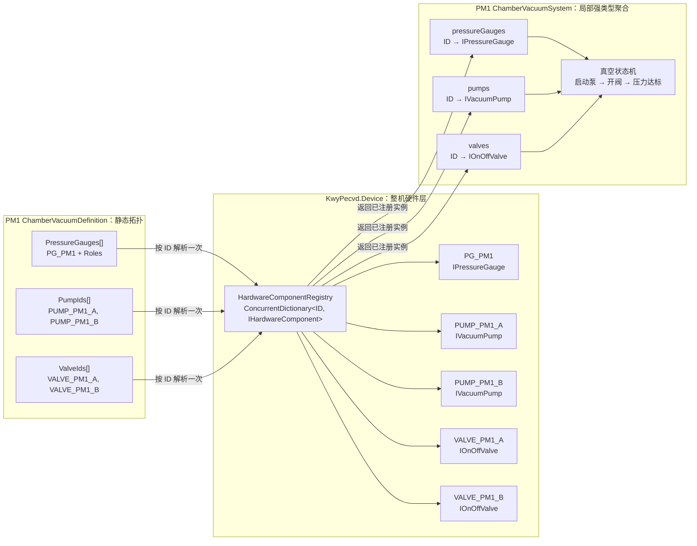

# KwyPecvd 腔体真空硬件拓扑

## 关系拓扑



## 职责边界

### HardwareComponentRegistry

- 是整机硬件实例的唯一注册源。
- 使用全局稳定硬件 ID 注册和查找实例。
- 管理硬件类型、身份和生命周期。

### ChamberVacuumDefinition

- 只描述某个 PM 与真实硬件 ID 的静态绑定。
- `PumpIds` 和 `ValveIds` 表示集合成员，不表示数组下标语义。
- 不创建、不注册、不持有硬件实例。

### ChamberVacuumSystem

- 构造时根据 Definition 中的 ID，从 Registry 解析真实实例。
- 校验硬件的 `ModuleId` 必须属于当前腔体。
- 保存不可对外修改的强类型字典视图。
- 批量操作遍历字典的 `Values`；指定硬件按 ID 查询。
- 它不是第二个 Registry，不拥有硬件生命周期。

## 运行时路径

```text
RT 组合根创建硬件
→ HardwareComponentRegistry.Add(component)
→ 创建 ChamberController(PM1)
→ ChamberVacuumSystem 按 Definition 的 ID 解析并缓存实例
→ StartPumpDownAsync 遍历 pumps.Values 启动全部泵
→ 全部泵运行后遍历 valves.Values 打开全部抽气阀
→ ExecuteCycleAsync 读取 pumpDownPressureGauge 和全部硬件反馈
→ 到达 ReadyPressure 后进入 Ready
```

## 约束

1. 禁止使用 `PumpIds[0]` 或 `ValveIds[0]` 表示业务角色。
2. 当前同一集合中的硬件具有相同动作语义：全部启动或全部打开。
3. 如果未来干泵、分子泵或不同阀门需要不同顺序，应引入抽气阶段或路径模型，不依赖集合顺序。
4. 硬件 ID 必须在整机范围唯一，且在创建腔体控制器前完成注册。

# KwyPecvd.Device层设计

## 一、总体分层模板

```
Process业务层
    ↓ 只依赖硬件接口
IHardware
    ↓
HardwareBase
    ↓
具体接入实现
├─ SimulatedHardware
├─ IoHardware
├─ PlcHardware
└─ BrandHardware
       ↓
    BrandBus
       ↓
    BrandProtocol
       ↓
 IByteStreamClient / PLC / IO
```

每层职责如下：

| 层               | 职责                                 |
| ---------------- | ------------------------------------ |
| `IHardware`      | 向 Process 提供稳定硬件能力          |
| `HardwareBase`   | 命令校验、并发、状态、诊断、安全规则 |
| `Simulated`      | 无真实硬件时模拟物理行为             |
| `Io/Plc`         | 适配通用 IO、PLC 点位                |
| `BrandHardware`  | 将品牌数据映射成通用硬件模型         |
| `BrandBus`       | 串行化一次请求—响应事务              |
| `BrandProtocol`  | 构造和解析纯协议报文                 |
| `IByteStreamClient` | 提供 TCP、Serial 等字节流通信能力          |

## 二、标准目录模板

假设增加一个 `Xxx` 硬件：

```
KwyPecvd.Device
└─ Xxx
   ├─ IXxx.cs
   ├─ XxxBase.cs
   ├─ XxxDefinition.cs
   ├─ XxxSnapshot.cs
   ├─ XxxMode.cs
   ├─ XxxDiagnosticCodes.cs
   │
   ├─ Simulated
   │  └─ SimulatedXxx.cs
   │
   ├─ Io
   │  ├─ IoXxx.cs
   │  └─ IoXxxDefinition.cs
   │
   ├─ Plc
   │  ├─ PlcXxx.cs
   │  └─ PlcXxxDefinition.cs
   │
   └─ Brand
      ├─ IBrandXxxBus.cs
      ├─ BrandXxxBus.cs
      ├─ BrandXxxProtocol.cs
      ├─ BrandXxxDefinition.cs
      ├─ BrandXxxStatus.cs
      └─ BrandXxx.cs
```

不需要每种硬件都创建全部目录。例如只读模拟量压力计可能只有：

```
PressureGauge
├─ PressureGaugeBase
├─ Simulated
└─ Io
```

只有存在具体串口品牌时才需要 `Bus/Protocol`。

## 三、硬件模型的四类数据

### 1. Definition：静态配置

~~~
public sealed record XxxDefinition
{
    public required string Id { get; init; }

    public required string ModuleId { get; init; }

    public required string DisplayName { get; init; }

    public required double FullScale { get; init; }

    public string Unit { get; init; } = "...";

    public double Tolerance { get; init; }

    public TimeSpan ToleranceDelay { get; init; }

    public void Validate()
    {
        // 静态配置校验
    }
}
~~~

放置：

- 硬件 ID；
- 所属模块；
- 单位和量程；
- 点位或通信地址；
- 容差；
- 超时时间；
- 安全模式。

不要放：

- 当前反馈；
- 当前命令；
- 是否在线；
- 当前报警。

### 2. Commanded：软件已接受的命令

例如：

```
private bool commandedOn;
private double targetSetPoint;
private XxxMode commandedMode;
```

含义是：

> 软件已经成功发送或底层驱动已经接受的命令。
>
> commandedMode：现在由哪种算法、按哪个变量控制？

因此顺序必须是：

```
await WriteCommandAsync(...);

// 写入成功后才能更新Commanded
commandedMode = mode;
```

不能先改 Commanded 再访问硬件，否则硬件写失败时，软件会形成假状态。

### 3. Actual/Feedback：硬件真实反馈

例如：

```
ActualMode
Feedback
IsRunning
IsOutputOn
PositionFeedback
PressureFeedback
```

它只能由周期读取产生：

```
ExecuteCycleAsync
→ ReadFeedbackAsync
→ XxxCycleResult
→ XxxSnapshot
```

命令方法不能直接伪造 Actual：

```
await pump.StartAsync();

// 此时只能确定：
CommandedOn = true

// 不能立即确定：
IsRunning = true
```

### 4. Diagnostic：解释当前异常

```
public static class XxxDiagnosticCodes
{
    public const string NotSampled =
        "XXX_NOT_SAMPLED";

    public const string Offline =
        "XXX_OFFLINE";

    public const string FeedbackBadQuality =
        "XXX_FEEDBACK_BAD_QUALITY";

    public const string DeviceFault =
        "XXX_DEVICE_FAULT";

    public const string OutOfTolerance =
        "XXX_OUT_OF_TOLERANCE";

    public const string ExchangeFailed =
        "XXX_EXCHANGE_FAILED";
}
```

建议诊断优先级：

```
通信离线
→ 反馈无效
→ 硬件故障
→ 控制超差
→ 正常
```

## 四、接口模板

```C#
public interface IXxx : IHardwareComponent
{
    XxxDefinition Definition { get; }

    XxxSnapshot Snapshot { get; }

    event EventHandler<XxxSnapshot>?
        SnapshotChanged;

    Task<CommandResult> StartAsync(
        CancellationToken cancellationToken = default);

    Task<CommandResult> StopAsync(
        CancellationToken cancellationToken = default);

    Task<CommandResult> SetTargetAsync(
        double target,
        CancellationToken cancellationToken = default);
}
```

接口应该表达硬件能力，而不是协议细节。

正确：

```C#
SetPressureAsync(2)
SetPowerAsync(500)
SetPositionAsync(30)
```

不合适：

```
SendCommandAsync("S:02...")
WriteRegisterAsync(100, 500)
SendFrameAsync(bytes)
```

后面这些属于品牌 Bus 或 PLC 适配层。

## 五、Base 类模板

```C#
public abstract class XxxBase :
    HardwareComponentBase,
    IXxx
{
    private readonly object syncRoot = new();

    private readonly SemaphoreSlim operationGate =
        new(1, 1);

    private XxxSnapshot snapshot;

    public XxxDefinition Definition { get; }

    public XxxSnapshot Snapshot
    {
        get
        {
            lock (syncRoot)
            {
                return snapshot;
            }
        }
    }

    public event EventHandler<XxxSnapshot>?
        SnapshotChanged;
}
```

#### 两种同步机制

```
syncRoot
→ 保护短时间内存访问
→ Snapshot、Commanded、超差时间

operationGate
→ 保护完整异步操作
→ 命令、轮询、停机不能同时访问硬件
```

不能这样：

```C#
lock (syncRoot)
{
    await WriteHardwareAsync(); // 不允许
}
```

标准写法：

```C#
await operationGate.WaitAsync(token);

try
{
    await WriteHardwareAsync(token);

    lock (syncRoot)
    {
        // 更新内存状态
    }
}
finally
{
    operationGate.Release();
}
```

## 六、命令模板

```
public async Task<CommandResult> SetTargetAsync(
    double target,
    CancellationToken cancellationToken = default)
{
    if (!IsTargetValid(target))
    {
        return CommandResult.Failure(
            ResultCodes.OutOfRange,
            "Target is outside the valid range.");
    }

    await operationGate
        .WaitAsync(cancellationToken)
        .ConfigureAwait(false);

    XxxSnapshot changed;

    try
    {
        lock (syncRoot)
        {
            if (snapshot.IsOffline)
            {
                return CommandResult.Failure(
                    ResultCodes.Offline,
                    $"Hardware '{Id}' is offline.");
            }

            if (!snapshot.IsFeedbackValid)
            {
                return CommandResult.Failure(
                    ResultCodes.NotReady,
                    $"Hardware '{Id}' feedback is invalid.");
            }
        }

        await WriteTargetAsync(
                target,
                cancellationToken)
            .ConfigureAwait(false);

        lock (syncRoot)
        {
            targetSetPoint = target;

            changed = snapshot with
            {
                TargetSetPoint = target,
                Timestamp = DateTimeOffset.UtcNow
            };

            snapshot = changed;
        }
    }
    finally
    {
        operationGate.Release();
    }

    PublishSnapshotChanged(changed);

    return CommandResult.Success();
}
```

关键原则：

```
参数校验
→ 状态校验
→ 硬件写入
→ 更新Commanded
→ 发布快照
```

------

## 七、周期模板

```
public override sealed async Task ExecuteCycleAsync(
    CancellationToken cancellationToken = default)
{
    await operationGate
        .WaitAsync(cancellationToken)
        .ConfigureAwait(false);

    XxxSnapshot? changed = null;

    try
    {
        var result =
            await ReadFeedbackAsync(cancellationToken)
                .ConfigureAwait(false);

        var outOfTolerance =
            CalculateOutOfTolerance(result);

        changed = CreateSnapshot(
            result,
            outOfTolerance);

        UpdateSnapshot(changed);
    }
    catch (OperationCanceledException)
        when (cancellationToken.IsCancellationRequested)
    {
        throw;
    }
    catch
    {
        changed = CreateExchangeFailedSnapshot();
        UpdateSnapshot(changed);

        throw;
    }
    finally
    {
        operationGate.Release();

        if (changed is not null)
        {
            PublishSnapshotChanged(changed);
        }
    }
}
```

正常周期尽量只做：

```
读取反馈
→ 计算诊断
→ 更新快照
```

周期中允许写入的情况只有：

1. 软件斜坡需要周期生成中间设定值；
2. 发现严重故障后撤销一次危险命令；
3. EtherCAT/PDO 这类周期输出映像。

------

## 八、底层扩展点模板

```
protected virtual Task InitializeCoreAsync(
    CancellationToken cancellationToken) =>
    Task.CompletedTask;

protected abstract ValueTask WriteTargetAsync(
    double target,
    CancellationToken cancellationToken);

protected abstract ValueTask<XxxCycleResult>
    ReadFeedbackAsync(
        CancellationToken cancellationToken);

protected virtual Task ShutdownCoreAsync(
    CancellationToken cancellationToken) =>
    Task.CompletedTask;
```

内部采样结果：

```
protected readonly record struct XxxCycleResult(
    double Feedback,
    bool IsOffline,
    bool IsFeedbackValid,
    bool IsFaulted,
    DateTimeOffset Timestamp);
```

它只用于：

```
具体实现 → Base
```

所以使用 `protected`，不需要成为公开业务模型。

------

## 九、三种接入方式

### IO/PLC 型

```
SetTargetAsync
→ 更新软件Ramp目标

ExecuteCycleAsync
→ 计算Ramp中间值
→ 写AO/PLC
→ 读AI/PLC反馈
```

适合：

- 模拟量 MFC；
- 加热输出；
- AO 控制阀。

### Serial/TCP 仪表型

```
SetTargetAsync
→ 立即发送命令并等待响应

ExecuteCycleAsync
→ 只查询状态
```

适合：

- Fujikin MFC；
- VAT节流阀；
- MKS RF；
- Pfeiffer真空泵。

### EtherCAT/PDO 型

```
SetTargetAsync
→ 更新输出映像

实时总线周期
→ 发送PDO

ExecuteCycleAsync
→ 读取输入映像
```

它表面上没有直接通信，但目标仍应立即写入实时控制层的输出映像。

------

## 十、品牌驱动模板

```
BrandXxx
→ 通用模型映射

BrandXxxBus
→ 一次完整请求/响应
→ SemaphoreSlim串行化

BrandXxxProtocol
→ 纯报文构造和解析

IByteStreamClient
→ TCP或Serial
```

例如：

```
public sealed class BrandXxx : XxxBase
{
    private readonly IBrandXxxBus bus;

    protected override ValueTask WriteTargetAsync(
        double target,
        CancellationToken cancellationToken) =>
        new(
            bus.WriteTargetAsync(
                target,
                cancellationToken));

    protected override async
        ValueTask<XxxCycleResult>
        ReadFeedbackAsync(
            CancellationToken cancellationToken)
    {
        var status =
            await bus.ReadStatusAsync(
                cancellationToken);

        return new XxxCycleResult(
            Feedback: status.ActualValue,
            IsOffline: !bus.IsConnected,
            IsFeedbackValid:
                status.IsValueValid,
            IsFaulted: status.HasFault,
            Timestamp: DateTimeOffset.UtcNow);
    }
}
```

品牌类不应该重新实现：

- 超差判断；
- 并发控制；
- Snapshot 锁；
- 通用诊断优先级；
- 事件发布。

这些留在 Base，形成高内聚。

------

## 十一、仿真实现模板

仿真不是简单地立即把 Feedback 设置成目标，而是模拟物理过程：

```
feedback +=
    (commandedTarget - feedback) *
    responseFactor;
```

这样才能测试：

- 等待到位；
- 超时；
- 超差；
- 状态流转；
- 停止过程；
- 联锁触发。

仿真实现通常保存：

```
private double commandedTarget;
private double feedback;
private bool isOffline;
private bool hasBadQuality;
private bool isFaulted;
```

`WriteTargetAsync` 只更新仿真目标：

```
commandedTarget = target;
```

`ReadFeedbackAsync` 才推进物理反馈：

```
feedback +=
    (commandedTarget - feedback) * 0.2;
```

------

## 十二、测试模板

每种新硬件至少验证：

```
1. 初始化前快照为未采样/离线
2. 第一次周期后反馈有效
3. 命令立即调用底层写入
4. 后续普通周期不重复写命令
5. Commanded与Actual明确分离
6. 越界目标被拒绝
7. 无效反馈拒绝危险命令
8. 超差超过ToleranceDelay后报警
9. 反馈恢复后清除超差
10. 安全命令失败后下周期重试
11. Shutdown进入SafeMode
12. 观察者异常不破坏硬件周期
```

## 一句话模板

以后增加硬件时，可以反复问这五个问题：

```
Definition：这台硬件不会变化的配置是什么？
Commanded：软件成功下发了什么？
Actual：硬件真实反馈了什么？
Diagnostic：Commanded与Actual为何不一致？
Safety：失效时应撤销成什么状态？
```

掌握这五层，MFC、泵、阀、温控器、RF 电源、运动轴和气缸本质上都是同一套思路：

```
命令意图
→ 硬件写入
→ 物理过程
→ 真实反馈
→ 状态与诊断
→ 安全回退
```

区别主要只是命令类型、反馈类型和底层通信方式。
